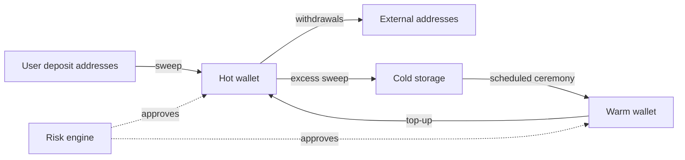

# Custody Tiers and the Exchange Threat Model

A centralised exchange holds other people's coins and must pay them out on demand. That single requirement drives every design decision in this book. Money that can leave quickly can also be stolen quickly, so exchanges split their holdings into tiers with different speed, controls and exposure. This chapter defines the tiers, the actors who attack them, and the assets you are actually protecting.

## Why tiers exist

No single wallet can be both instant and safe. A fully automated signer can approve a withdrawal in seconds, but anyone who controls the automation controls the funds. A key in a bank vault behind three signers and a 48-hour ceremony is safe from remote attackers, but it cannot fund a Monday-morning withdrawal spike. Tiering is the compromise: keep only what you need for the next few hours online, and refill it from slower, more protected storage.

| Tier | Typical share of assets | Signing | Latency | Main risk |
|---|---|---|---|---|
| Hot | small single-digit % | automated, policy-gated | seconds to minutes | remote compromise of signer or pipeline |
| Warm | a larger buffer | semi-automated, human approval or quorum | minutes to hours | approver deception, insider collusion |
| Cold | the majority | offline or air-gapped, multi-party ceremony | hours to days | ceremony manipulation, UI deception, physical theft |

The percentages are policy; treat published targets as claims until audited. The engineering point is that the hot tier's balance is your **worst-case loss from a remote compromise of the hot signer**, so it should be sized from withdrawal statistics, not from convenience.

## Money flows between tiers



Deposits are swept into the hot wallet and excess flows down to cold; refills move up. Every arrow is a transaction someone signs. Label each arrow with *who* signs, *what* checks run, and *which* destinations are allowed. The withdrawal arrow has unconstrained destinations and is the most dangerous; arrows between your own wallets should be limited to a fixed allowlist of internal addresses.

## Assets you are protecting

It is tempting to say "the private keys". In practice the attacker rarely needs the raw key. They need a valid signature on a transaction they chose. That gives a longer asset list:

- **Signing keys or key shares** in HSMs, MPC nodes, or hardware wallets.
- **Signing authority**: credentials to the API that asks the signer to sign.
- **Transaction intent**: the database row that says "pay 2 BTC to address A". If an attacker can edit it, the signer will happily sign their transaction.
- **Display integrity**: what approvers see on screens and devices. Several major incidents involved approvers signing something different from what their screen showed.
- **Address books and whitelists**: changing a whitelisted address is equivalent to choosing the destination.
- **Ledger and balance data**: if the internal ledger can be inflated, a legitimate pipeline will pay out stolen value.
- **Smart contract wallets**: for EVM chains, the multisig contract's owners, threshold, modules and implementation address.

## Threat actors

| Actor | Typical entry | What they want |
|---|---|---|
| State-backed groups (notably DPRK clusters) | social engineering of engineers, supply-chain compromise of wallet vendors, fake job offers | large one-shot thefts from cold or warm tiers |
| Financially motivated criminals | credential stuffing, SIM swap, phishing of support staff | user account takeover, small hot-wallet drains |
| Insiders | legitimate access | quiet theft, ledger manipulation, collusion with outsiders |
| Vendors and dependencies | compromised custody provider, SDK, CI pipeline | access to many exchanges at once |
| Users | API abuse, race conditions in withdrawal logic | double withdrawals, negative balances |

The sibling book **dprk-crypto-threat-operations** covers the first row in depth. For this book the important observation is that the largest public exchange losses of 2024 and 2025 were attributed by law enforcement to that cluster, and they targeted the *process around signing* rather than breaking cryptography.

## Trust boundaries

Draw the boundary where a single compromise is enough to move funds. Common single points:

1. The withdrawal service account that can call the signer without further checks.
2. A shared admin credential for the HSM or MPC cluster.
3. The CI/CD pipeline that deploys the signer or the policy engine.
4. The front-end that renders transaction details to cold-storage approvers.
5. A custody vendor whose software runs on approver machines.

The design goal is that no item on this list can move more than the hot-tier limit on its own. Anything above that must cross at least one independent boundary: a different team, a different device, a different network, a different vendor.

## Worked example

> **Execution status:** not executed in this book's CI. Commands, code and expected results below are written from documentation, not observed output; verify locally.

Set up a three-tier toy custody system on Bitcoin regtest to make the flows concrete.

1. Start a node and create wallets for each tier:

```bash
bitcoind -regtest -daemon -fallbackfee=0.0002
bitcoin-cli -regtest createwallet hot
bitcoin-cli -regtest createwallet warm
bitcoin-cli -regtest createwallet cold
bitcoin-cli -regtest createwallet miner
```

2. Fund the miner and send most coins to cold, a buffer to warm, a little to hot:

```bash
M=$(bitcoin-cli -regtest -rpcwallet=miner getnewaddress)
bitcoin-cli -regtest generatetoaddress 110 "$M"
for t in cold:30 warm:5 hot:1; do
  w=${t%%:*}; amt=${t##*:}
  a=$(bitcoin-cli -regtest -rpcwallet=$w getnewaddress)
  bitcoin-cli -regtest -rpcwallet=miner sendtoaddress "$a" "$amt"
done
bitcoin-cli -regtest generatetoaddress 1 "$M"
```

3. Print balances per tier with `getbalances` and write down, for each tier, who would sign in production and what check gates it.
4. Simulate a withdrawal spike: send ten 0.2 BTC withdrawals from `hot`. The sixth fails for lack of funds. That failure is the signal your refill process must handle, and it shows why hot sizing comes from withdrawal statistics.

## Common pitfalls

- Sizing the hot wallet "to avoid refills" instead of from observed peak outflow plus margin.
- Treating internal transfers as safe and not constraining their destinations.
- Protecting keys while leaving the withdrawal-request database writable by many services.
- Assuming cold storage is safe because it is offline, while approvers use online machines to view what they sign.
- Ignoring vendors: custody SDKs and wallet-provider software sit inside the trust boundary.

## Exercises

1. Draw your own flow diagram for a real or hypothetical exchange and label every arrow with signer, checks and allowed destinations.
2. From a CSV of hourly withdrawals (synthetic is fine), compute the 99th-percentile 6-hour outflow and propose a hot-wallet ceiling.
3. List five single points of compromise in the regtest setup above and propose one control for each.

## Further reading

- Bitcoin Core RPC documentation: <https://developer.bitcoin.org/reference/rpc/>
- CryptoCurrency Security Standard (CCSS), CryptoCurrency Certification Consortium (C4)
- NIST SP 800-57 Part 1, Recommendation for Key Management
- See **dprk-crypto-threat-operations** and **mpc-wallet-security** in this library
