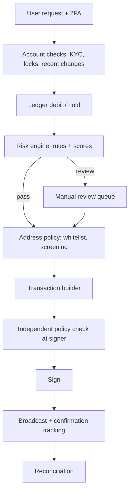

# Withdrawal Pipelines and Risk Engines

A withdrawal turns a database number into an irreversible transfer. Everything before the signature is a chance to stop a bad payout. This chapter walks the pipeline and places the risk checks.

## The pipeline



Two design rules matter more than any individual check.

**Hold before you sign.** Debit or place a hold on the user balance in the same database transaction that creates the withdrawal record. If the balance check and the debit are separate statements, two concurrent requests can both pass the check. This is the classic double-withdrawal race and has hit many smaller platforms.

**Check twice, independently.** The risk engine decides whether a withdrawal *should* happen. The signer, separately, must decide whether the transaction it is asked to sign *matches* an approved withdrawal. If the signer trusts the builder blindly, compromising the builder bypasses every rule upstream.

## Risk engine rules

A risk engine is usually auditable deterministic rules plus a score that catches patterns rules miss.

| Rule | Example threshold | Why |
|---|---|---|
| Recent security change | password, 2FA, email or phone changed in last 24–72 h | account takeover often starts with changing recovery factors |
| New destination | first withdrawal to an address | most theft goes to fresh addresses |
| Velocity per user | more than N withdrawals or X value per hour | limits damage from a single compromised account |
| Velocity per asset | hot-wallet outflow for asset above a rolling baseline | detects pipeline compromise, not just user compromise |
| Login anomaly | new device, new country, Tor exit | session theft |
| Screening | destination linked to sanctioned or stolen-funds clusters | compliance and stolen-funds tracing |
| Value tier | above per-user or per-asset threshold | routes to manual review or warm tier |

The **per-asset velocity** rule deserves emphasis. User-level rules protect users from account takeover. Asset-level rules protect the exchange from its own pipeline being compromised, where every individual withdrawal looks fine but the aggregate does not.

## Address whitelisting

Whitelisting means users (and internal wallets) can only send to addresses registered in advance. Good implementations:

- require 2FA and an email confirmation link to add an address;
- enforce a cooling-off period (commonly 24 hours or more) before a new address is usable;
- notify the user on every channel when an address is added;
- store the whitelist with integrity protection, so a database edit alone does not change it (for example, each entry signed by a key held outside the main application).

For internal flows (hot to cold, warm to hot), the allowlist should be a short, hard-coded or signed set of addresses enforced *at the signer*. A refill transaction to an address outside that set is never legitimate.

## Building the transaction

The builder chooses inputs, fee and change. Points that create risk:

- **Change address validation.** For UTXO chains, the change output must go to an address the exchange controls. A builder that takes change addresses from a mutable table can be tricked into "change" that pays an attacker.
- **Fee caps.** Enforce an absolute and relative maximum fee. A fee bug can burn a large amount in one transaction.
- **Nonce management** on account chains. Gaps or reuse stall the queue; operators under pressure then make manual changes, which is where mistakes happen.
- **Token decimals and contract addresses.** Paying the wrong token contract or misreading decimals turns a 1.0 withdrawal into 1,000,000.

## Signer-side policy

The signer (HSM application, MPC policy engine, or co-signer service) should parse the actual transaction and check:

1. Destination and amount match a withdrawal ID approved by the risk engine.
2. The withdrawal ID has not been used before (replay).
3. Change returns to a known internal address.
4. Fee is within caps.
5. Rolling outflow for this key is within its limit.

Commercial MPC and custody platforms ship policy engines for this; if you build your own, keep the policy code small and reviewed separately from the rest of the stack. The sibling book **mpc-wallet-security** discusses where policy lives in MPC deployments.

## Using AI in review queues

Some teams use language models to summarise flagged withdrawals for reviewers. The model only proposes: every fact must link to the underlying record, the decision stays with deterministic rules and a human, and model output never feeds the signer.

## Worked example

> **Execution status:** not executed in this book's CI. Commands, code and expected results below are written from documentation, not observed output; verify locally.

Prove the double-withdrawal race and its fix with PostgreSQL locally.

1. Create a balance table:

```sql
CREATE TABLE balances (user_id int PRIMARY KEY, amount numeric NOT NULL CHECK (amount >= 0));
INSERT INTO balances VALUES (1, 1.0);
```

2. The unsafe pattern reads, checks in application code, then writes. Run two sessions in parallel that each `SELECT amount` (both see 1.0), then each `UPDATE balances SET amount = 0.2 WHERE user_id = 1` after "paying" 0.8. Both succeed and 1.6 has been paid from a 1.0 balance.
3. The safe pattern makes the database enforce it atomically:

```sql
UPDATE balances SET amount = amount - 0.8
WHERE user_id = 1 AND amount >= 0.8
RETURNING amount;
```

Run it from two sessions at once. One returns a row, the other returns zero rows. Only create the withdrawal record when a row is returned, in the same transaction.

4. Add a test harness (for example a short Python script with `psycopg` and a thread pool) that fires 50 concurrent withdrawals and asserts that the sum paid never exceeds the starting balance. The checker, not code review, decides whether the fix holds.

## Common pitfalls

- Separate balance check and debit statements, enabling races.
- Risk rules only at user level, so a compromised pipeline sending many small withdrawals goes unnoticed.
- Signer that signs whatever the builder sends.
- Whitelist stored as a plain table any service account can update.
- Fee and decimals not capped at the signer.

## Exercises

1. Implement the per-asset rolling outflow rule over a synthetic stream of withdrawals and tune it so it would have alerted on a 10x spike within 15 minutes.
2. Extend the PostgreSQL harness to include a withdrawal record insert and show that a crash between debit and insert cannot lose funds.
3. Write the signer-side checks above as a function that takes a decoded PSBT (from `bitcoin-cli decodepsbt`) and a JSON approval, and returns accept or reject with a reason.

## Further reading

- PostgreSQL documentation, "Transaction Isolation": <https://www.postgresql.org/docs/current/transaction-iso.html>
- FATF guidance on virtual assets and the travel rule (2019, updated 2021)
- BIP 174, Partially Signed Bitcoin Transactions: <https://github.com/bitcoin/bips/blob/master/bip-0174.mediawiki>
- See **mpc-wallet-security** for policy engines in threshold signing
